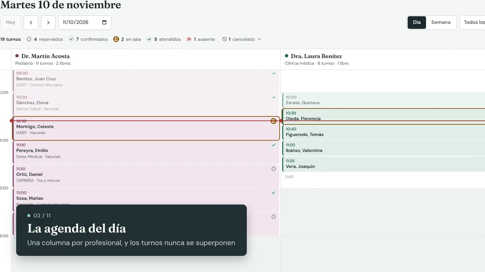

# Turnos

Sistema de turnos para consultorios. Se instala en la PC de recepción y cubre el día completo: agenda de varios profesionales, sala de espera, recordatorios por WhatsApp, historia clínica, cobros por obra social y reportes. Funciona sin internet.



[Ver el video de la demo en mi portafolio](https://sergio-cardozo.vercel.app/#p-turnos)

## Qué hace

- Agenda por día y por semana para varios profesionales, cada uno con su horario y la duración de sus turnos. No deja dar dos turnos a la misma hora y muestra los próximos horarios libres.
- Recepción y sala de espera: quién llegó, cuánto lleva esperando y quién ya fue atendido.
- Recordatorios por WhatsApp en un clic, con el nombre, el día y la hora del turno.
- Historia clínica por paciente, visible solo para los profesionales. Cada nota se cierra al terminar el día.
- Cobros particulares o por obra social, con el detalle por forma de pago.
- Reportes de ausentismo, ocupación de cada profesional y cobros por obra social, con exportación a Excel.
- Usuarios con PIN y roles para administración, profesionales y recepción.

## Aspectos técnicos

- **Permisos controlados en el proceso principal:** no solo en la interfaz. Los PIN se guardan con scrypt y sal, y la pantalla se bloquea sola después de un rato sin uso.
- **Turnos que no se pisan:** la propia base de datos impide que dos turnos se superpongan.
- **Datos en el consultorio:** SQLite con Drizzle y migraciones versionadas, con copias de seguridad automáticas que se restauran desde la app.

## Tecnologías

Electron · React · TypeScript · Tailwind CSS · shadcn/ui · TanStack Query · Zod · SQLite con Drizzle · Vitest

## Cómo ejecutarlo

Necesitás [Node.js](https://nodejs.org) en su versión LTS.

```bash
npm install
npm start          # abre la aplicación en modo desarrollo
npm test           # corre las pruebas automatizadas
npm run typecheck  # revisa los tipos de TypeScript
npm run make       # genera el instalador (en Windows, el .exe)
```

La primera vez que se abre, el sistema pide crear el primer usuario con su PIN. Un administrador puede cargar datos de ejemplo (un consultorio con profesionales, pacientes y turnos) mientras no haya pacientes cargados.

## Estructura

```
src/
  main/        proceso principal de Electron: base de datos, servicios y canales IPC
  preload/     puente seguro entre la ventana y el proceso principal
  renderer/    interfaz en React
  compartido/  tipos, esquemas de Zod y cálculos que usan los dos lados
pruebas/       pruebas automatizadas con Vitest
```

## Autor

**Sergio Cardozo**, desarrollador full stack en Formosa, Argentina.
[Portafolio](https://sergio-cardozo.vercel.app) · [LinkedIn](https://www.linkedin.com/in/sergiocardozo-dev) · [GitHub](https://github.com/Gabicrdz)
